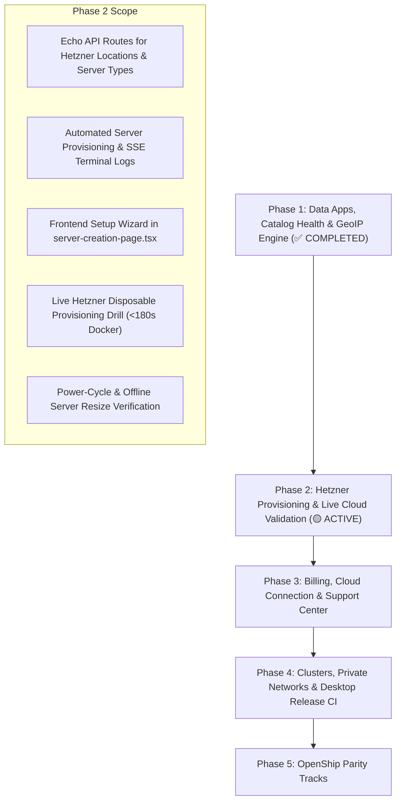

# OpenShip vs Codedock: Live Target & Platform Roadmap

> **Status**: In Progress 🟡  
> **Active Phase**: Phase 2 — Hetzner Provisioning Wizard & Live Cloud Validation  
> **Completed**: Phase 1 (Data Apps, GeoIP Engine & Catalog Health CI) ✅; Phase 2 provisioning engine + dashboard wizard ✅ (live drill run still pending)  
> **Last Updated**: October 16, 2026 (upstream `4d4068641` / v0.9.2 reviewed: 8 new catalog apps, Cloudflare managed ingress, GPU containers, bounded build cache, roles follow-through, Cloud Spaces presentation, Emails-for-all sidebar; roadmap extended with tracks 33–35)

---

## Progress Dashboard

### Core Platform Capabilities

- [x] **1. Managed-Server Setup Wizard** (Hetzner automated provisioning, cloud-init terminal SSE)
- [ ] **2. Codedock Cloud Offering** (HA control plane, `pg_advisory_lock` leadership, reverse agent tunnels)
  - [ ] Cloud-gated openship features to adopt once the plane exists: authorization identity with account/org switching, relay + import isolation enforcement, provisioning authority ownership, cloud workspace lifecycle drills
  - [ ] Presentation note (v0.9.2, no data-model change): upstream renamed managed capacity to "Cloud Spaces" — one purchased workspace = one pool, never summed; Resources page (overview/activity, live `format=usage` monitor stream, per-project storage) replaces server tabs on cloud installs; Emails sidebar entry shown everywhere (cloud gets connect-external-IMAP/SMTP client, self-hosted keeps mail-server admin). Adopt the wording/user-model when the cloud plane exists; nothing to port self-hosted.
- [x] **3. Cloud Connection & Deploy Flow** (Pairing handshake, deploy modal, credit alerts at <15% and 0%)
- [x] **4. Support Center** (Gated route `/_dashboard/support`, category routing, conversation threads)
- [x] **5. Billing & Usage Experience** (Monthly tiers + custom configurator, PAYG top-ups, resource meters, Stripe recovery)
- [x] **6. Server Clusters & Network Editors** (K3s pool management, WireGuard mesh, 120s rollback watchdog)
- [x] **7. Full Managed Data Apps** (Supabase multi-service, Convex backend/dashboard, Neon branching server)

### Live-Target Validation Backlog

- [ ] **8. Live Hetzner Provisioning & Bootstrap Drill** (API creation → cloud-init Docker → SSH reachability → resize)
- [ ] **9. Live K3s Installation & Operator Recovery** (Cluster bootstrap, CloudNative-PG & Redis failover drills)
- [ ] **10. Compose & Backup Recovery Exercises** (Named volumes, Minisign/S3 target, synthetic wipe & restore)
- [ ] **11. Multi-Host HA Spread & Failover Drills** (WireGuard mesh latency matrix, MTU checks, split-brain tolerance)
- [x] **12. Maintainer Install Pass & Verified Badges** (`.github/workflows/catalog-health.yml` nightly matrix)
- [x] **13. GeoIP Database for Traffic Geography** (official MaxMind GeoLite2-Country, country resolution in proxy)
- [ ] **14. Desktop Sidecar Bundling & Notarization CI** (Tauri 2.0 `externalBin`, Minisign updater, Apple Notarytool)

### OpenShip Parity Tracks (Phase 5)

- [x] **15. List Search** (Escaped `ILIKE` `?search=`/`?q=`, name→ID fan-out, URL-synced debounced inputs)
- [x] **16. Notification Settings** (Shared channels/subscriptions/delivery editor for settings + monitoring)
- [x] **17. Backups Page Layout** (Summary-first stacked layout, storage header, simplified skeletons)
- [x] **18. CI-Style Actions** (Workflow/run/runner engine, triggers, sidebar section, run workspace, terminal logs, and runner catalog)
- [x] **33. Managed Ingress** (Cloudflare Tunnel per server + DNS/Access management, CLI and SDK parity — see §5.18)
- [x] **34. GPU Containers** (Validated NVIDIA device requests, preflight hints, server GPU override — self-hosted Docker only, see §5.19)
- [x] **35. Bounded Build Cache** (Project-owned BuildKit state, package-cache mounts, storage-pressure GC — see §5.20)
- [x] **19. Mail Seam Guardrails** (Contract tests pin all 11 maild paths + auth + error mapping; identity rule verified — no FKs into mail tables; maild-side `/v1` versioning stays with `codedock-mail`)
- [x] **20. Public App Catalog Pages** (Marketing directory + per-app detail pages, sitemap, catalog docs)
- [x] **21. Qualified Catalog Stacks** (One-click authentik, mariadb, nextcloud, odoo, postgresql, rabbitmq, wordpress)
- [x] **22. Managed Server Controls** (Outbound/SSH/network tabs, tab model, API routes, CLI command)
- [ ] **23. Smaller Parity Items** (Deployment GitHub checks, build admission, host-port option, i18n foundation, webmail signatures/quotes)
- [x] **24. Stack Roles & Framework Detection** (Gate-based role presets, dep/filecontent detection, explicit config overrides)
- [x] **25. Runtime Version Selection** (Stack-aware PHP/toolchain picker, matched build images, custom-base validation)
- [ ] **26. Webmail Live Inbox** (IMAP IDLE push refresh, unbuffered SSE, folder routing — `codedock-mail` scope)
- [ ] **27. SDK Backend Checklist** (v1 stability policy, WS Bearer auth, CORS origins, token bootstrap, generated client, cloud prerequisites)
- [x] **28. Service Domain Aliases** (Multiple aliases sharing one port survive routing normalization + integration test)
- [x] **29. Stack Role Follow-Through** (Laravel cache warming in resolved web command, measured Rails stop grace, per-card stack icon)
- [x] **30. Monitoring Clear-History** (Scoped confirmation to clear resolved attention issues)
- [x] **31. Strict Duration Parsing** (Whole-or-nothing compose timing values + tests)
- [x] **32. Billing Intent Hygiene** (Settle pricing intents before new payment; selection flows straight to checkout — see §3.1)

---

## Phase-by-Phase Execution Plan

---

## Phase 1: Managed Data Apps, Catalog Health & GeoIP (Completed ✅)

### 1.1 Full Managed Data Apps

- [x] **Supabase Template** ([`supabase.yaml`](file:///C:/Users/USER/Projects/codedock/internal/engine/compose/supabase.yaml)):
  - Service `db`: `supabase/postgres:17.6.1.136` with healthcheck (`pg_isready`).
  - Service `kong`: `kong:3.9.1` declarative API gateway routing `:8000` to internal microservices with buffer tuning.
  - Service `auth`: `supabase/gotrue:v2.189.0`.
  - Service `rest`: `postgrest/postgrest:v14.12`.
  - Service `realtime`: `supabase/realtime:v2.102.3`.
  - Service `storage`: `supabase/storage-api:v1.60.4`.
  - Service `meta`: `supabase/postgres-meta:v0.96.6`.
  - Service `studio`: `supabase/studio:2025.02.19`.
  - Secrets: `POSTGRES_PASSWORD`, `JWT_SECRET`, `ANON_KEY`, `SERVICE_ROLE_KEY`, `SECRET_KEY_BASE`, `PG_META_CRYPTO_KEY`, `DASHBOARD_PASSWORD`.
- [x] **Convex Template** ([`convex.yaml`](file:///C:/Users/USER/Projects/codedock/internal/engine/compose/convex.yaml)):
  - Service `backend`: `ghcr.io/get-convex/convex-backend` exposing `:3210` (API) and `:3211` (HTTP actions).
  - Service `dashboard`: `ghcr.io/get-convex/convex-dashboard` exposing `:6791`.
  - Secrets: `INSTANCE_SECRET` (32 bytes).
- [x] **Neon Template** ([`neon.yaml`](file:///C:/Users/USER/Projects/codedock/internal/engine/compose/neon.yaml)):
  - Service `neond`: `neond/neond` bundling pageserver, safekeeper, broker, and web UI.
  - Published branch ports: `55432-55437` and console port `3000`.
  - Secrets: `SERVER_SECRET`, `ADMIN_PASSWORD`, `PG_PASSWORD`.
  - Logo added: `apps/dashboard/public/app-logos/neon.svg`.

### 1.2 GeoIP Database & Traffic Resolution

- [x] Vendored `GeoLite2-Country.mmdb` downloaded directly from MaxMind (release `GeoLite2-Country_20261009`, SHA-256 verified).
- [x] Maintainer script [`scripts/update-geoip.sh`](file:///C:/Users/USER/Projects/codedock/scripts/update-geoip.sh) now pulls from MaxMind's official download API with SHA-256 verification.
- [x] Built Go GeoIP reader in [`internal/engine/traffic/geoip.go`](file:///C:/Users/USER/Projects/codedock/internal/engine/traffic/geoip.go):
  - Resolves ISO 3166-1 alpha-2 country codes for public IPs via embedded database.
  - Ignores loopback, private (RFC 1918), and link-local addresses.
  - Injected `Country` into `models.TrafficSample` and `traffic_visitors` table.
  - Verified with unit tests in `parser_test.go`.

### 1.3 Maintainer Install Pass (`catalog-health.yml`)

- [x] Created [`.github/workflows/catalog-health.yml`](file:///C:/Users/USER/Projects/codedock/.github/workflows/catalog-health.yml):
  - Nightly scheduled run (`17 4 * * *`) and workflow dispatch.
  - Job 1: Template spec validation via Go test.
  - Job 2: Disposable test container health validation across key data apps (PostgreSQL, Redis, MinIO, Neon, Convex).

---

## Phase 2: Hetzner Provisioning Wizard & Live Hetzner Validation (Active 🟡)

### 2.1 Backend Provisioning Engine & Handlers

- [x] Managed-server routes shipped in `internal/http/managed_setup.go` (paths differ from the original plan; verified Oct 14):
  - `GET /api/managed/catalog` and `GET /api/organizations/:id/managed/credentials/:credentialId/offers` (live locations/types)
  - `POST /api/organizations/:id/managed/servers/review` (+ `/resize/review`, `/delete/review`)
  - `GET /api/managed-operations/:operationId/stream` (SSE logs)
- [x] Wire up `internal/engine/hetzner/userdata.go` cloud-init generator with Docker CE and SSH security baseline. (Now wired via `managed_provision.go`; verified Oct 14.)

### 2.2 Dashboard Setup Wizard

- [x] Multi-step Hetzner wizard UI exists in `apps/dashboard/src/features/servers/` (`managed/hetzner-setup-wizard`, `hetzner-plan-step.tsx`, `hetzner` creation-mode toggle in `server-creation-page.tsx`) — landed after Oct 12; backend routes from 2.1 now shipped.
- [x] Live terminal SSE view tracking (`hetzner-progress-view.tsx` + `managed_stream.go`): `creating_server` → `waiting_ip` → `bootstrapping_cloud_init` → `ssh_verified`.

### 2.3 Live Hetzner Validation Drill

- [ ] Run live end-to-end provision drill on disposable Hetzner Cloud project:
  - Assert cloud-init bootstrap finishes in <180 seconds.
  - Assert SSH connectivity and Docker socket responsiveness.
  - Assert power-cycle & resize (`cx22` → `cpx21`) keeps data volume intact.
  - Assert clean deletion without dangling resources.

---

## Phase 3: Billing, Cloud Connection & Support Center

### 3.1 Billing & Usage Experience

- [x] Flesh out route `/_dashboard/billing` (shell `apps/dashboard/src/routes/_dashboard.billing.tsx` exists; none of the below verified present Oct 13):
  - [x] `billing-overview.tsx`: Active tier, renewal date, Stripe customer portal redirect.
  - [x] `custom-plan-configurator.tsx`: Interactive vCPU / RAM / SSD quota sliders.
  - [x] `billing-topups.tsx`: PAYG pre-paid credit packages ($10 to $250).
  - [x] `resource-meter.tsx`: Visual usage bars against purchased limits.
  - [x] `checkout-recovery.tsx`: Post-checkout webhook settlement verification watchdog.
- [x] Guide server deletion through subscription cancellation (openship PR
  #1174: deletion flow surfaces the subscription gate with onboarding copy, so
  paid servers cannot be orphaned; `managed-server-action-feedback.tsx`).
- [x] Settle pricing intents before starting another payment and continue
  pricing selections directly to checkout (openship `b04474484`, `f68fc5057`,
  `cloud-purchase-intent.ts`).

v0.9.2 billing-recovery deltas (Oct 16): pending checkouts expose
`canCancel` + `cancelUnavailableReason` (`unsupported|provider_unavailable`),
cancel saves `{checkoutId, idempotencyKey}` before dispatch, re-reads the
original and enforces ID match, and uncertain outcomes stay tracked instead of
being cleared (`billing-checkout-recovery.ts`, `CheckoutRecovery.tsx`,
`checkout-recovery.test.ts`). Portable rule for codedock's Stripe flow:
reason enum, idempotency-key-then-verify-terminal, never clear on uncertain.

### 3.2 Cloud Connection & Deploy Flow

- [x] Cloud connection management in settings (`cloud-connection-card.tsx`).
- [x] Cloud deploy plan picker on project deployment settings (`cloud-deploy-plan-modal.tsx`).
- [x] Credit alert banners (`<15%` warning, `0%` critical gate blocking new compute).

### 3.3 Support Center

- [x] Add route `/_dashboard/support`:
  - `support-ticket-list.tsx`: Ticket overview with status pills and topic badges.
  - `support-conversation.tsx`: Interactive markdown message thread with staff responses.
  - `new-ticket-modal.tsx`: Ticket composer with optional diagnostic bundle upload.
  - Gated to Cloud-linked instances or Cloud-hosted environments.

---

## Phase 4: Clusters, Private Networks & Desktop Release CI

### 4.1 Clusters & Private Networks

- [ ] WireGuard mesh editor in `apps/dashboard/src/features/servers/networks/`:
  - Prerequisite tool check (Python, iproute2, WireGuard tools).
  - Automated 120-second rollback watchdog preventing lost node access.
  - Peer latency matrix, packet loss, and MTU diagnostics.
- [ ] K3s Cluster setup editor in `apps/dashboard/src/features/servers/clusters/`:
  - Control-plane and worker assignment.
  - Ingress and Service placement tracking.

### 4.2 Live K3s & Operator Recovery Drills

- [ ] Live cluster deployment drill on disposable nodes.
- [ ] PostgreSQL / Redis failover operator recovery exercises under network partition.
- [ ] Multi-container backup and restore verification drill against S3.

### 4.3 Desktop Sidecar Release & Notarization CI

- [ ] Tauri 2.0 configuration (`apps/desktop/src-tauri/tauri.conf.json`):
  - Bundle `bin/codedockd` via `externalBin`.
  - Generate Minisign updater ed25519 keypair.
- [ ] GitHub Actions workflow `.github/workflows/release-desktop.yml`:
  - macOS notarization via Apple Notarytool (`apple-actions/import-codesign-certs`).
  - Universal binary builds (Apple Silicon `aarch64` + Intel `x86_64`) and Windows installers.

---

## Phase 5: Search, Notifications, Backups, Actions & Mail Parity

Parity with openship (`oblien/openship` at `4d4068641`, v0.9.2 — reviewed Oct 16;
was `b2e50f1a` + `75df170f` + `e7c79f25`) tracks 15–35. No new infrastructure unless
stated. Keep every touched file within repo limits (350 lines, one component
per file).

### 5.1 List Search (track 15)

Openship evidence: no engine in product path (Meili/ES exist only as deployable
service templates); product search is Postgres `ILIKE` via Drizzle —
`?search=` on list endpoints (`deployment.controller.ts:25`), escaped literals
(`deployment.repo.ts:103-113`), multi-column OR incl. JSONB + parent `EXISTS`,
cross-entity `q` with parallel name→ID fan-out capped at 200 with per-resolver
failure isolation (`audit.service.ts:26-33`, `project.repo.ts:132-145`), facets
over the same filter set, and URL-synced 300–350ms debounced inputs
(`AuditLog.tsx:501-560`).

- [x] `internal/repositories/search.go` (LIKE-wildcard escaping + `ILIKE`
  clause builder); `search` threaded through project/deployment/database/service/
  server lists; `AuditLogRepo.ListFiltered` upgraded from `LIKE` to escaped `ILIKE`.
- [x] Handlers accept/trim/cap `search` / `q`; documented in `internal/http/apischema`;
  co-located `search_test.go` (escaping, case-insensitivity, empty-term passthrough).
- [x] Capped `SearchIDsByName` per repo + isolated fan-out for the audit feed;
  `Facets` honors the same filters.
- [x] Dashboard `use-debounced-search` hook with TanStack Router URL sync, page
  reset, and TanStack Query keys carrying the settled term.
- [x] Docs update in `apps/docs`; `%`, `_`, `\` match literally everywhere.

### 5.2 Notification Settings (track 16)

Openship evidence (`cc30406e`): 689-line settings tab gutted to a ~7-line wrapper
around shared `components/notifications/NotificationSettings.tsx` (channels card,
per-category subscriptions with org defaults, delivery history), reused by
Monitoring/issues and emails admin. Backend untouched — endpoints pre-existed.

- [x] Backend: channel CRUD, per-category subscriptions with org defaults,
  and delivery-history list exist (`internal/notifications/`,
  `internal/repositories/notification_settings.go`); delivery history added
  (`notification_deliveries` table, dispatcher recording, list endpoint).
- [x] Frontend: shared channels/subscriptions components plus new delivery
  history card; settings route stays a thin wrapper; co-located tests.

### 5.3 Backups Page Layout (track 17, frontend only) ✅

Openship evidence (`8c80ab75`, zero backend files): described in the section
below. Implemented: stacked summary-first layout with compact storage header,
simplified skeletons, borderless destinations card — same treatments.

Openship evidence (`8c80ab75`, zero backend files): `backups/page.tsx` moved from
a two-column grid to a stacked single column headed by a compact
`BackupStorageSummary` card; simplified skeletons; borderless destinations card
with `text-sm` heading and `sr-only` description; row icon chips on background
fill; pattern recorded in `docs/dashboard-design.md`.

- [x] Restack `_dashboard.backups.index.tsx` summary-first with a storage-summary
  header above destination history and the destinations list (endpoints in
  `internal/http/routes.go:243-244` already exist).
- [x] Apply the same card treatment and skeletons; record the pattern in `apps/docs`.

### 5.4 CI-Style Actions (track 18)

Openship evidence: sidebar entry in `lib/sidebar-nav.ts:62`; engine commit
`c08f243c` (213 files: API module, workflow/triggers/lifecycle/execution/runner
engine, billing, SDK client, e2e tests); dashboard `/actions` home, editor, run
workspace, runners/billing pages.

- [x] Backend MVP: `action_workflows` / `action_runs` / `action_runners` models, handlers/routes (CRUD, retry/cancel, runner heartbeat), and OpenAPI schema coverage.
- [x] Engine & execution lifecycle: queued → running → ready/failed/cancelled status transitions with step timing and persisted logs.
- [x] Dashboard: sidebar entry `/actions`, tabbed home (workflows, runs, runner catalog), run workspace with terminal log viewer and retry/cancel actions, runner registration modal.
- [x] Acceptance: create → run → retry/cancel → inspect loop from dashboard, 13 new unit tests passing across 4 suites.

v0.9.2 deltas (Oct 16, `4d4068641`): upstream removed Cloud-runner UX from the
self-hosted flow (`RunnerDestination` drops temporary mode; `useActions`
re-exported from `use-scoped-resource`), made Cloud list failures fall back to
local data (`cloud-operations.ts`, `cloud-actions.test.ts`), and runs official
runner containers as non-root (`github.go` `--user uid:gid`, `main.go` prints
cause). Portable pieces for the codedock MVP: local-fallback on remote failure,
scoped-resource hooks, non-root runner user.

### 5.5 Mail Seam Guardrails (track 19)

Context: mail ships as a separate repo (`codedock-mail`: own Go module, own
`maild` daemon, Stalwart provisioner, independent releases) while openship keeps
mail in-monorepo (`apps/email`, `packages/db-email`). Both enforce the same rule
— HTTP seam, no shared DB. Codedock holds only reference rows
(`internal/handlers/mail/mail.go`, `internal/services/mail`, `/mail/*` routes)
and calls `maild` over HTTP. These guardrails keep the split from rotting:

- [ ] Version the `maild` HTTP API explicitly (`/v1` prefix + compatibility
  window); reject breaking changes without a version bump.
- [x] Cross-repo contract tests on the codedock side covering every `MailService`
  call (servers, domains, mailboxes, DKIM, DNS, checks, certs) so a `maild`
  release cannot silently break `/mail/*`. (`mail_contract_test.go` pins all 11 paths + Bearer auth + 404/unreachable mapping; verified Oct 14.)
- [ ] Enforce the reference-row identity rule: platform admins manage, mailboxes
  authenticate — no FKs, no merged user tables, ever (mirrors openship
  `apps/email/ARCHITECTURE.md` three-layer rule).
- [ ] Declare the UI boundary: separate `apps/admin` shell vs thin
  `_dashboard.mail.tsx` — shared tokens only by decision, never by drift.

### 5.6 Public App Catalog Pages (track 20)

Openship evidence (`41c7718c`, Oct 12): new marketing section
`apps/web/.../(marketing)/apps/` — directory page, per-app detail pages,
dedicated stylesheet, sitemap entry, catalog docs, and 8 new app logos; follow-up
kept category navigation visible while scrolling.

- [x] Add an `apps/` directory + per-app detail routes to `apps/web` (landed as
  `templates/$templateId` with services, secrets, verified badge, and setup-guide
  CTA; catalog cards link to detail pages with docs fallback).
- [x] Drive pages from the compose-template catalog: `generate:apps` script
  parses `x-codedock` metadata into a committed TS module, chained into `build`.
- [x] Sitemap entries for catalog pages; catalog docs coverage for new stacks.

### 5.7 Qualified Catalog Stacks (track 21)

Openship evidence (`5e416a0a`, Oct 13, plus Oct 14 logos): authentik, mariadb,
nextcloud, odoo, postgresql, rabbitmq, wordpress enabled as qualified one-click
stacks with install-routing test updates; followed by ghost, gitea, minio, n8n,
supabase, and umami logos.

- [x] Add `internal/engine/compose` templates for the same stacks with
  secrets, healthchecks, and dashboard logos, following the Phase 1
  Supabase/Convex/Neon pattern (extend to ghost, gitea, minio, n8n, supabase,
  umami).
- [x] Extend the install-routing tests and the nightly `catalog-health.yml`
  matrix to cover the new templates.

Implemented Oct 14: `authentik.yaml` (server + worker + Postgres + Redis,
v2026.8.3) and `odoo.yaml` (app + Postgres, v18). mariadb, rabbitmq, and
postgres stay engine templates (service-level `is_database` bindings for
provisioned databases), not catalog apps. nextcloud, wordpress, ghost, gitea,
minio, n8n, supabase, and umami were already one-click with metadata.
Follow-up: brand SVGs for authentik/odoo added in `apps/dashboard/public/app-logos/` (Simple Icons brand SVGs).

v0.9.2 catalog wave (Oct 16, `4d4068641` — 8 new apps, all `framework:
docker-compose` with pinned published images, no inline builds):
homepage (dashboard + Caddy basic-auth sidecar), immich (server + ML worker +
valkey + vector Postgres), jellyfin (single service, needs new `entrypointArgv`
field), ollama (CPU or 1 NVIDIA GPU, internal-only `:11434`), open-webui
(optionally binds Ollama via `bundleId`), paperless-ngx (+ Postgres + valkey),
wiki-js (+ Postgres), vllm (preview, `available:false`, GPU-required, 2 GiB
`shmSize`). Upstream nightlies now cover 14 apps (added paperless-ngx, wiki-js,
homepage, immich, jellyfin, ollama, open-webui) plus retired-build conversion
jobs for wordpress/odoo. Upstream odoo moved to official `odoo:19.0-20260926`
and wordpress to `wordpress:7.1.3-php8.3-apache` with mounted startup helpers
instead of builds (`1f842b5fa`); codedock's `odoo.yaml` still pins v18.
Template-schema concepts worth adopting when codedock's validation grows:
`gpus`/`shmSize` service fields, `supportsCloud`, `requires[].bundleId`,
`generateGroup` shared secrets, `minEngine` version gates.

- [x] Qualify the v0.9.2 wave as codedock compose templates (paperless-ngx,
  wiki-js, homepage, immich, jellyfin, ollama, open-webui; vllm only if a GPU
  host exists to test against), following the authentik/odoo pattern.
- [x] Evaluate bumping `odoo.yaml` 18 → 19 and adopting the official-image +
  mounted-helper style for odoo/wordpress (`odoo:19.0-20260926` + `postgres:17-alpine`).
- [ ] Extend `catalog-health.yml` matrix toward upstream's 14-app coverage.

### 5.8 Managed Server Controls (track 22)

Openship evidence (`8536edb1`, Oct 11): new outbound-controls tab (357-line
component), SSH tab rework, network tab updates, a `server-tabs` tab model, new
API routes with a 267-line test, and a matching CLI command.

- [x] Add outbound/SSH/network tabs to the codedock server detail views in
  `apps/dashboard/src/features/servers/` (which already hosts overview, security,
  settings, and terminal tabs). (Already present: the managed server page mounts
  `networking` (outbound internet + egress allowlist + gateway IP), `ssh`,
  `workloads` and `runtimeApi` tabs with a tab model; verified Oct 14.)
- [x] Backend routes + a CLI surface mirroring the existing server-management
  shapes; co-located tests per repo convention. (Routes `GET/PATCH
  /servers/:id/network-settings` and the managed SSH/runtime/workload routes
  already existed; added `codedock servers network <id>` and
  `servers network set <id> --internet --egress --confirm` with client tests.
  Openship's cloud-only managed egress *proxy/IP* control does not map to
  codedock's self-hosted servers and was not ported.)

Upstream divergence (Oct 16, v0.9.2 `d2e1a04a9`): openship deleted its managed
tab components (`ManagedServerOutbound`, `ManagedServerSsh`,
`ManagedServerNetwork`, `ManagedServerRuntime`, `ManagedServerSettings`,
`ManagedServerWorkloads`, `useManagedServerResource`, 646-line
`managed-controls.test.tsx`) and now renders managed pools through a
Resources view with 2 tabs (overview/activity); backend routes
(`network-settings`, `managed/*`) still exist but the managed UI no longer
calls them. Codedock keeps its outbound/SSH/network tabs — correct for
self-hosted servers where the operator owns the host. No action; recorded so
a future diff of `server-tabs.ts` (now 7 flat tabs upstream) is not
misread as a regression.

### 5.9 Smaller Parity Items (track 23, break out as needed)

Observed in openship history since mid-September, not yet deep-dived —
each needs its own evidence pass before implementation:

- [x] Configurable deployment GitHub checks (`2f30b02b`; compare with codedock
  `internal/repositories/pr_preview.go`).
- [x] Durable cloud build admission + saved plan limits (`ba914eab`).
- [x] Explicit alternative host port for deployments (`c192ce10`).
- [ ] Dashboard i18n foundation, then full parity (openship reached 100% key
  parity across 9 locales in PR #1170: 20 system background jobs, audit event
  sentences, relative timestamps, notification category registry, credentials,
  edge diagnostics, monitoring health, pricing locales, `brand.json`). Codedock
  dashboard has no locale system yet — foundation (provider, `t.*` wiring,
  parity test) first, then per-surface passes in the same order.
- [ ] Webmail signatures and reply-quotes (openship #1121/#1122; applies to
  `codedock-mail`, not the platform repo).
- [x] Ephemeral host-port exclusion (v0.9.2 `b0d6cf849` / `371931b90`): never
  allocate or reuse inside the kernel ephemeral range (Linux default
  32768–60999, read from `/proc/sys/net/ipv4/ip_local_port_range`); move
  unsafe legacy pins to a safe port at deploy time, fail before reserving when
  exhausted. Fully portable to codedock's Docker port allocator; copy the
  `host-port.test.ts` cases (overlap pool, owned-pin moves, fallback).
- [x] Dashboard clickjacking guard (v0.9.2 `f9d36507c`): `CSP frame-ancestors
  'none'` + `X-Frame-Options: DENY` on dashboard/auth routes with a
  framing-protection test; customer app routing/headers unchanged.
- [x] Edge trusted proxies & proxy CIDR validation (v0.9.2 `fa82a5596`): validate
  `CODEDOCK_EDGE_TRUSTED_PROXIES` and `CODEDOCK_EDGE_REAL_IP_HEADER`; drop malformed
  CIDRs safely, configure Traefik entrypoint trusted IPs, and bind Echo RealIP extractor.
- [x] Personal appearance settings & CSS token validation (v0.9.2 `ad8353fca` + follow-ups): user-scoped
  theme tokens (validated, no `;{}<>\url()`), server-side `appearance` settings column with
  partial upsert, and `GET/PUT /settings/appearance`.
- [ ] i18n follow-ups: upstream added an `ingress.json` namespace across all 10
  locales plus billing/settings/servers renames (mostly Cloud rebrand — keep
  `server` wording). Still blocked on the codedock dashboard locale-system
  foundation first.

### 5.10 Stack Roles & Framework Detection (track 24)

Openship evidence (PR #976): pure `packages/core/src/stack-roles.ts` — explicit
`openship.json` roles win outright; otherwise preset roles apply only when
`when`/`unless` gates match detected deps (e.g. Gemfile gems) and files, with
ambiguous kinds dropped; `stacks.ts` declares roles per stack.

Codedock today stops at file-marker labels (`detectLanguageStack` in
`internal/engine/build/railpack_builder.go:144-167` returns display strings for
logging/template choice) — no roles, no dep-content gates, no overrides.

- [x] Add role presets per stack (web/worker/scheduler shapes) with
  `when`/`unless` gates over detected deps and files; explicit service config
  always wins; drop ambiguous matches rather than guessing. (`internal/engine/stacks`:
  `ResolveStackRoles`, registry presets for Laravel/Rails, dep parsing for
  package.json/composer.json/Gemfile/requirements.txt/go.mod, file walking;
  verified Oct 14.)
- [x] Wire resolved roles into compose generation (service topology, stop grace
  periods) with co-located Go tests. (Repository inspection resolves roles and
  returns them; creating an app with roles creates its worker/scheduler services;
  each service carries a stop grace period applied as the container stop timeout.)

v0.9.2 roles hardening (Oct 16, `4d4068641` — all single-app Docker, gated by
a `supports("roles")` capability the cloud runtime lacks; directly applicable):
singleton handover (renames/command changes stop + retain outgoing singletons
before starting replacements, `planSingletonHandover`), strict startup
verification (exactly one stable finding per replica; exit-0 `completed`,
missing/duplicate findings fail startup), `PORT` stripped from role containers
(image-inherited and project-defined), move/copy refusal while role work is
live/saved/unsettled, failed retirement surfaces as a deployment warning with
container identity instead of failing the deploy, `when`/`unless` on declared
roles warn rather than silently gate, Laravel scheduler preset 90s → 10s +
SIGTERM (`0c92bc55c`, GH-935). Pinning tests: `role-rollout.test.ts`,
`role-runtime.test.ts`, `role-lifecycle.test.ts`, `runtime-roles.e2e.test.ts`,
`roles-sdk-parity.test.ts`, `docker-role-container.test.ts`.

- [x] Port the v0.9.2 roles hardening: singleton handover ordering, strict
  per-replica startup verification, `PORT`-unset in role containers, move
  guards while role work is live, retire-failure-as-warning, Laravel
  scheduler 10s/SIGTERM default.

### 5.11 Runtime Version Selection (track 25)

Openship evidence (PR #1166): stack-aware picker UI (`BuildSettings.tsx`),
matched build + FrankenPHP versions, Laravel presets, Docker recipes selected by
stack, custom-base validation, e2e coverage. Codedock delegates all of this to
Railpack with no user control.

- [x] Add a version picker to the deployment build settings (dashboard),
  constrained to versions the stack templates actually support.
- [x] Backend validates the selection (reject unknown/custom bases) and records
  the resolved toolchain on the deployment; extend build e2e coverage.

Implemented Oct 15 (`a428741a`): `runtime_version` on app services (migration
025) set via `PUT /api/apps/:id/build` alongside build commands, exposed in
dashboard Build Settings, and recorded in the OpenAPI schema. Railpack/Nixpacks
builds inject `NIXPACKS_<LANG>_VERSION` + `RAILPACK_<LANG>_VERSION` env pins
matched to the detected stack (Node/Python/Go/Rust/PHP/Ruby); versions are
trimmed and format-validated on every write path, and role-spawned workers
inherit the pin. Custom-base image validation stays open (codedock builds go
through Railpack, not per-stack Dockerfiles).

### 5.12 Webmail Live Inbox (track 26, `codedock-mail` scope)

Openship evidence (PR #1167): IMAP IDLE pushes immediate mailbox refresh;
SSE flushed through buffering proxies (`X-Accel-Buffering: no` in
`apps/email/server/src/routes/idle.ts`); SSE timeout + folder-routing tests.
No IDLE/SSE/live-refresh exists in `codedock-mail` today.

- [ ] Push IDLE events to the client over unbuffered SSE with folder routing and
  reconnect/timeout tests, mirroring the openship idle-route shape.
- [ ] Same-host backend access via Docker host gateway with validated
  `extra_hosts` entries (openship PR #1172: `container-hosts.ts` validation,
  host-gateway e2e test); honor SMTP host mappings and bound browser sign-in
  (`smtp.ts` rework + connection fixtures).

v0.9.2 mail evidence (Oct 16, `4d4068641` — all `codedock-mail` scope):
`POST /webmail/deploy-external` installs the stock webmail client against an
*existing* IMAP/SMTP backend — only hosts/ports + provider label cross the
API, no mailbox passwords; per-user IMAP passwords are encrypted at rest with
a generated `SESSION_ENCRYPTION_KEY` and entered at webmail sign-in
(`webmail-install.service.ts`, `cloud-mail-client.tsx`). `mail-availability`
gate: mail-server administration only on local control plane; cloud/generic
installs get the connect-external client. Resizable inbox/reading panes with
persisted layout and keyboard controls (`mail-panels.tsx` + test). Fail2ban
hardening: dedicated root-only PostgreSQL sidecar credentials written every
boot, nftables multiport comma fix, ban/unban failures return errors instead
of false success (e2e `mail-fail2ban-db`). Webmail sign-in attempts get
bounded timeouts instead of hanging.

- [ ] External-backend webmail install (hosts/ports only over the API,
  generated session-encryption key, passwords at sign-in, never stored).
- [ ] `canManageMailServers`-style gate if `codedock-mail` ever ships a
  hosted variant; resizable mail panes; fail2ban sidecar-credential pattern.

### 5.13 SDK Backend Checklist (track 27, self-hosted + cloud)

The Go backend already carries most of the weight: `/api/v1/*` rewrite
(`internal/http/echo_middleware.go:26-28`), Bearer auth with CSRF exemption
for machine callers (`:56-63`), PAT/project tokens with scopes and
anti-escalation, CORS with `Authorization` allowed, and a served OpenAPI
registry (`serveOpenAPISpec`) pinned by `schema_coverage_test`. Remainder:

- [x] Verify WebSocket upgrades accept Bearer tokens (log streaming is core
  SDK surface).
- [x] Configurable extra CORS origins for self-hosted browser-embedded SDK use,
  or document server-side-only.
- [x] Token bootstrap beyond dashboard UI (`codedock login` / device flow).
- [x] State the v1 stability rule (v1 frozen, breaking changes go to v2).
- [x] Full `@codedock/sdk` client bindings for ingress, networks, clusters, actions, and billing with typechecking and unit test suite.
- [ ] Cloud prerequisites (already roadmap items 2–3): account-level auth,
  pairing handshake, per-plan rate limits, billing gates, per-tenant CORS —
  the SDK itself stays `baseUrl` + token throughout.

v0.9.2 SDK surface deltas (Oct 16): compose sync aborts on blocking GPU/shm
validation errors (`sdk/compose.ts` + `compose.test.ts`), monitor streams take
an opt-in `format=usage` (`server-client.ts`, `server-monitor.test.ts`;
pairs with pause-on-hidden + 45s-stall + 60-sample history in
`useMonitorStream`), new `GET/PUT /settings/appearance` client, 8 DNS ingress
ops (`dns-client.ts`, `ingress.test.ts` — only if codedock adopts track 33).

- [x] Adopt the portable pieces: GPU/shm compose-sync validation, `format`
  param on log/monitor streams, appearance settings client.

### 5.14 Service Domain Aliases (track 28)

Openship evidence (`2c90a353a` + 160-line integration test): multiple service
domain aliases sharing one port must all survive routing normalization.

- [x] Cover alias-sharing-a-port in the Traefik/route-rule normalization tests
  (`route_rule.go`, domains), using their integration test as a template.
  Gap found: codedock stored multiple `domains` per service but only routed the
  primary `app.Domain`, so aliases did not route at all (no normalization to
  test). Implemented: `deploy.NormalizeRouteHosts` dedupes by hostname
  (primary first) and `ContainerManager.buildTraefikLabels` now emits one router
  per host, all bound to the service port, honoring `path_prefix`; the deployer
  loads domains via a `DomainFetcher` bound to the domain repo. Unit tests cover
  alias-sharing-a-port. Compose-stack and bare runtimes remain single-domain.

### 5.15 Stack Role Follow-Through (track 29)

Openship evidence: Laravel cache warming wired into the resolved web command
(`bb1e6d27f`, `b43efb0e3`), measured Rails stop grace periods (`b97e1cbd9`),
per-card `ProjectStackIcon` (29 lines + tests).

- [x] Extend track 24 presets with role-specific behaviors (cache warming,
  measured stop grace) once roles resolve. (Laravel `optimize` flag runs the
  stack's `php artisan optimize` before start; role stop grace is persisted and
  applied as the container stop timeout; verified Oct 14.)
- [x] Add a detected-stack icon to project cards. (Services carry the detected
  stack; project cards show a stack chip.)

v0.9.2 follow-through deltas (Oct 16): Laravel scheduler measured at 10s +
SIGTERM while queue/Horizon workers keep 90s; web-role `optimize` stays
opt-in. No further action unless codedock's Laravel preset diverges.

### 5.16 Monitoring Clear-History (track 30)

Openship evidence (`56387559f`): clear resolved history behind a scoped
confirmation dialog.

- [x] Add a "clear resolved" action over `attention_issues` with scoped
  confirmation and audit logging. (`attention.Service.ClearHistory` + admin-gated
  `DELETE /organizations/:id/attention/history`, feed exposes `canClearHistory`,
  dashboard inline confirmation; audited as `attention.history.clear`; verified Oct 14.)

### 5.17 Strict Duration Parsing (track 31)

Openship evidence (`duration.ts` + `9281a075e`): compose timing values parse
whole-or-nothing — never a silently half-read duration.

- [x] Apply whole-or-nothing duration parsing to compose handling with unit
  tests over valid and malformed timing formats. (`ParseComposeDuration` in
  `internal/engine/compose/duration.go` — bare seconds, d/w units,
  signs/decimals, overflow guard — now used by catalog healthcheck validation;
  verified Oct 14.)

### 5.18 Managed Ingress via Cloudflare Tunnel (track 33)

Openship evidence (v0.9.2 PR #1268 `b6281f99a` + fixes, ~6.5k lines, guide
`apps/web/content/docs/guides/cloudflare-tunnel.mdx`): per-server Cloudflare
tunnel management explicitly built for self-hosted installs (Cloud managed
servers keep their existing routing; `connect()` rejects `workspaceId` and
`CLOUD_MODE`). Model: one `ingress_connection` per server (existing|managed
connector, Cloudflare credential, `defaultForDomains` auto-enroll) + one
`ingress_hostname` per published hostname with an ownership ledger
(zone/dns/app/policy/rule IDs; write-intent saved before provider calls, only
the ledger authorizes cleanup). Engine reconciles Access app → project edge
route → tunnel rule → DNS CNAME with 30s sweeps and capped exponential
backoff; removal reverses DNS → rule → Access and only deletes owned
resources. Dashboard: per-server card on the Security tab (connect/discover/
defaults/retry/disconnect), per-domain status with phase
(access→tunnel→dns→ready), auto-enroll banner; CLI `dns ingress ...`; SDK
`dns-client` ingress ops + `ingress.test.ts`; 10-locale `ingress.json`.

- [x] Model one tunnel connection per server + hostname ledger with ownership
  tracking; reconcile loop with retry/backoff that only touches owned
  resources.
- [x] Server Security-tab card (connect/discover/defaults/retry/disconnect),
  per-domain status + policy switch, `dns ingress` CLI commands, SDK ops.
- [x] Pinned `cloudflared` connector install via CLI client and dashboard integration.

### 5.19 GPU Containers (track 34)

Openship evidence (v0.9.2, operator contract `docs/gpu-containers.md`):
self-hosted Docker only — requires host NVIDIA driver + Container Toolkit,
refused on cloud. Compose import/SDK/CLI share validated GPU selection
(`compose-gpu.ts`: nvidia-only, `count all|0..64`, device IDs/UUIDs, ≤16
groups; invalid blocks before image acquisition, non-GPU silently ignored).
Runtime sends `HostConfig.DeviceRequests` + captures adoption on inspect;
`runtime:nvidia` exempted from unsupported-runtime rejection. Preflight
`checkGpuTarget` warns only, never blocks; server GPU override
(`yes|no|NULL`, `0190_server_gpu_override`) with mismatch warnings in a
`GpuCard` fed by Docker `/info` probe (`Runtimes.nvidia` + `nvidia.com/gpu`
device indexes). Catalog side: `gpus`/`shmSize` template fields, `gpu:
recommended|required`, CPU mode strips to `NVIDIA_VISIBLE_DEVICES=void`.

- [x] Validated GPU request parsing (nvidia-only, counts/device IDs, invalid
  blocks early) shared by compose import and any SDK/CLI sync.
- [x] Docker device-requests on service create/update + preflight warn-only
  GPU check + server GPU override with mismatch warning.
- [x] Catalog `gpus`/`shmSize` fields for GPU-capable templates (ollama-style).

### 5.20 Bounded Build Cache (track 35)

Openship evidence (v0.9.2, `docs/build-cache.md`): native Docker keeps a 5 GiB
bounded project-owned BuildKit state (per-project `${worker}_state` volume,
label-inventoried, LRU + 7d-idle + pressure eviction, never walks app/DB
volumes, skips attached/protected), asserts daemon storage before builds
(`409 BUILD_STORAGE_LOW`), and injects `--mount=type=cache,sharing=locked`
prefixes for npm/bun/pnpm/pip/composer/cargo/go/maven/gradle/dotnet/hex plus
stack `buildCacheDirs`, with `OPENSHIP_BUILD_CACHE_MOUNTS=false` opt-out.
Cloud-only pieces (provider software disks, workspace host plumbing) do not
apply to codedock. Note upstream also stopped turning omitted CPU/RAM limits
into sampled capacity caps — containers share host capacity unless explicitly
limited; worth mirroring when codedock's meters grow.

- [x] Project-owned bounded BuildKit cache volume with LRU/idle/pressure
  eviction and pre-build storage assertion.
- [x] Package-manager cache mounts in generated Dockerfiles with opt-out;
  record stack `buildCacheDirs` alongside role presets.
